  

  

I enjoy building software, troubleshooting technical problems, and exploring how applications and infrastructure work together. My interests span **backend development, IT infrastructure, networking, cloud computing, and automation**.

Right now I'm combining hands-on IT support experience with software development and cloud learning to build reliable, scalable, and maintainable solutions.

---

## 🚀 About Me

| | |
|---|---|
| 💼 **Role** | IT Support Executive |
| 🔭 **Building** | Billing Software and web applications |
| 🌱 **Learning** | Cloud Computing, DevOps, deployment, infrastructure automation |
| 🐍 **Backend** | Python, FastAPI, REST APIs, WebSockets |
| 🖥️ **Infrastructure** | Windows troubleshooting, hardware support, user administration, endpoint management |
| 🌐 **Networking** | LAN/WAN fundamentals, VLANs, firewalls, troubleshooting |
| ☁️ **Cloud interests** | AWS, Azure, virtualization, cloud-hosted applications |
| 🤝 **Open to** | Backend, IT infrastructure, cloud, DevOps, open-source collaboration |
| ⚡ **Fun fact** | I enjoy connecting the dots between software, systems, and networks. |

---

## 🛠️ Tech Stack

### Programming & Backend

### Databases & Storage

### Cloud, DevOps & Automation

<b>📖 Click to expand: full skills breakdown</b>

 

**Programming & Backend**
- Languages: Python, JavaScript, TypeScript, C++
- Frameworks: FastAPI, Django, React, Node.js
- Concepts: REST APIs, WebSockets, authentication, application architecture

**Databases & Storage**
- PostgreSQL, MongoDB, SQLite, Redis, Supabase
- Database integration and application data management

**Cloud, DevOps & Automation**
- Cloud: learning cloud platforms, deployment, cloud infrastructure
- Containers: Docker fundamentals
- Version control: Git and GitHub
- CI/CD: GitHub Actions and continuous integration concepts
- Operating systems: Windows and Linux fundamentals
- Scripting: Python, Bash, PowerShell fundamentals

**IT Support & Infrastructure**
- 💻 Hardware diagnostics and laptop troubleshooting
- 🪟 Windows support and software installation
- 👤 User accounts, permissions, and access troubleshooting
- 🌐 LAN/WAN troubleshooting and VLAN fundamentals
- 🔥 Firewall and endpoint security administration exposure
- 🖨️ Printer, peripheral, and office IT support
- 🛡️ Endpoint management and software compliance awareness
- 🖥️ Virtualization using VirtualBox and VMware

---

## 📂 Featured Projects

<table>
  <tr>
    <td width="33%" valign="top">
      <h3>💬 Omegle Clone</h3>
      
Real-time one-to-one chat with random matching and private conversations.

      <ul>
        <li>⚡ WebSocket messaging</li>
        <li>🔄 Random user matching</li>
        <li>🐍 FastAPI backend</li>
      </ul>
      

        
        
      

      <a href="https://github.com/Dhannuchanda/omegle-chat-app">View Project →</a>
    </td>
    <td width="33%" valign="top">
      <h3>🌐 Portfolio Website</h3>
      
A personal site showcasing my projects, skills, and development journey.

      <ul>
        <li>🎨 Responsive UI</li>
        <li>⚛️ React + Tailwind CSS</li>
        <li>📱 Desktop and mobile</li>
      </ul>
      

        
        
      

      <a href="https://github.com/Dhannuchanda/portfolio-site">View Project →</a>
    </td>
    <td width="33%" valign="top">
      <h3>🧾 Billing Software (in progress)</h3>
      
Simplifying everyday business billing workflows.

      <ul>
        <li>🛠️ Practical business focus</li>
        <li>📊 Maintainable architecture</li>
        <li>🔧 Iterative development</li>
      </ul>
      

        
      

      <i>Tech stack to be updated.</i>
    </td>
  </tr>
</table>

---

## ☁️ Cloud & DevOps Journey

I'm expanding from traditional IT support into cloud infrastructure and DevOps practices.

```mermaid
flowchart LR
    A[🐧 Linux & CLI] --> B[🌐 Networking<br/>DNS · HTTP/S]
    B --> C[🐳 Docker]
    C --> D[🔁 Git & CI/CD]
    D --> E[☁️ AWS & Azure]
    E --> F[🏗️ Deploy & Automate]
    F --> G[📈 Monitor & Troubleshoot]
    style A fill:#0f2027,stroke:#36BCF7,color:#fff
    style B fill:#0f2027,stroke:#36BCF7,color:#fff
    style C fill:#0f2027,stroke:#36BCF7,color:#fff
    style D fill:#0f2027,stroke:#36BCF7,color:#fff
    style E fill:#0f2027,stroke:#36BCF7,color:#fff
    style F fill:#0f2027,stroke:#36BCF7,color:#fff
    style G fill:#0f2027,stroke:#36BCF7,color:#fff
```

**My goal:** combine IT support experience and backend development skills to help build, deploy, maintain, and troubleshoot production systems.

---

## 📊 GitHub Analytics

 

 

 

---

## 🐍 Contribution Snake

<picture>
  <source media="(prefers-color-scheme: dark)" srcset="https://raw.githubusercontent.com/Dhannuchanda/Dhannuchanda/output/github-contribution-grid-snake-dark.svg" />
  <source media="(prefers-color-scheme: light)" srcset="https://raw.githubusercontent.com/Dhannuchanda/Dhannuchanda/output/github-contribution-grid-snake.svg" />
  
</picture>

---

## 🤝 Let's Connect

I'm interested in connecting with developers, IT professionals, cloud engineers, and teams building useful technology.

 

⭐ If you find my work useful, consider starring a repository!

